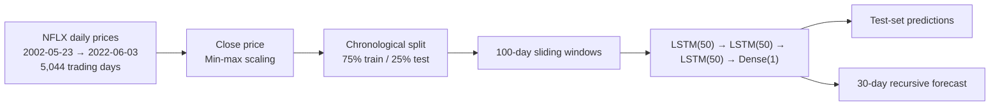

<div align="center">

# Bharat Intern · Data Science Projects

**Two end-to-end notebooks from the Bharat Intern data science internship:<br>
LSTM stock-price forecasting and Titanic survival classification.**


</div>

---

## Projects

| # | Project | Task | Model | Notebook |
|---|---|---|---|---|
| 1 | **Netflix stock-price forecasting** | Time-series regression | Stacked LSTM (TensorFlow / Keras) | [`Stock Prediction.ipynb`](Stock%20Prediction.ipynb) |
| 2 | **Titanic survival prediction** | Binary classification | Logistic regression (scikit-learn) | [`Titanic Survival project.ipynb`](Titanic%20Survival%20project.ipynb) |

---

## 1. Netflix stock-price forecasting

Forecasts Netflix's daily closing price from its own history with a three-layer LSTM, then rolls the
model forward to project the next 30 trading days.



| Item | Details |
|---|---|
| Data | Daily OHLCV for NFLX (`Date, Open, High, Low, Close, Adj Close, Volume`), 5,044 rows |
| Target | `Close`, scaled to [0, 1] |
| Split | First 75% (3,783 days) train, last 25% (1,261 days) test, in time order |
| Input | 100-day windows predicting the next day |
| Model | Three stacked LSTM layers of 50 units and a dense output; MSE loss, Adam, 100 epochs, batch 64 |
| Forecast | 30 days ahead, feeding each prediction back in as the next input |

## 2. Titanic survival prediction

Predicts whether a passenger survived from their class, sex, age, family aboard, fare and port of
embarkation.

| Step | Details |
|---|---|
| Data | `tested.csv`, 418 passengers, 12 columns |
| Cleaning | `Sex` and `Embarked` label-encoded; missing `Age` and `Fare` filled with the column mean |
| Features | `Pclass`, `Sex`, `Age`, `SibSp`, `Parch`, `Fare`, `Embarked` |
| Exploration | Survival counts overall, by sex and by passenger class |
| Split | 75% train / 25% test (`random_state=2`) |
| Model | Logistic regression |

---

## Getting started

```bash
git clone https://github.com/Aman-Tripathi27/Bharat-Intern.git
cd Bharat-Intern
pip install pandas numpy matplotlib seaborn scikit-learn tensorflow jupyter
jupyter lab
```

The datasets are not committed. Place them next to the notebooks:

| File | Contents | Used by |
|---|---|---|
| `NFLX.csv` | Netflix daily price history in the Yahoo Finance column format | Stock prediction |
| `tested.csv` | Titanic passenger list with a `Survived` column | Titanic |

## Repository structure

```text
Bharat-Intern/
├── Stock Prediction.ipynb           # LSTM forecasting of NFLX closing prices
└── Titanic Survival project.ipynb   # logistic-regression survival classifier
```

## Known issues

- **Titanic:** the feature matrix is built by dropping only `Cabin`, `Name`, `Ticket` and
  `PassengerId`, so the target `Survived` is still one of the inputs. The 100% train and test accuracy
  in the notebook comes from that leak, not from the model; drop `Survived` from `X` before quoting a
  score. In this CSV the label counts also mirror `Sex` exactly (266 / 152), so expect a near-perfect
  score from `Sex` alone.
- **Stock prediction:** the RMSE cells compare targets still on the [0, 1] scale with predictions
  already converted back to dollars, so those two numbers are not meaningful. Inverse-transform
  `y_train` and `y_test` too, and fit the scaler on the training split only.

---

<div align="center">
<sub>Built by <a href="https://github.com/Aman-Tripathi27">Aman Tripathi</a> · <a href="https://amantripathii.netlify.app">Portfolio</a> · <a href="https://www.linkedin.com/in/aman-tripathi27/">LinkedIn</a></sub>
</div>
